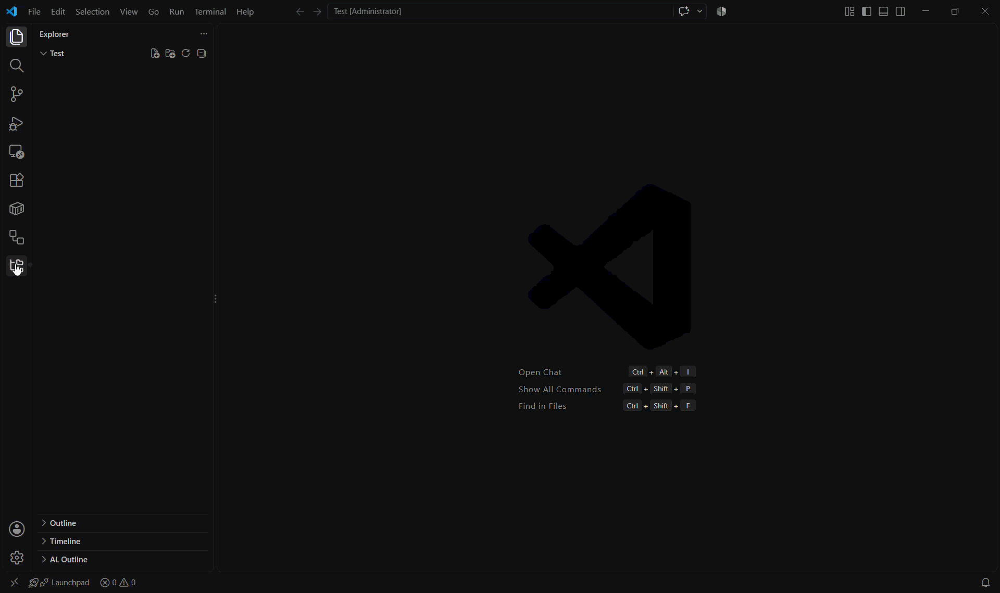

# Default Projects

**Stop recreating the same project structure by hand.** Default Projects lets you define your own project templates once (folders, files and even file contents) and spin up a fresh, ready-to-use project from them in just a few clicks.

Whether you start a new Python script every other day, keep a standard layout for your notes, or need the same boilerplate in every client project, Default Projects gets you from "empty folder" to "ready to work" in seconds.

## Why Default Projects?

- **Save time.** No more copying old projects, deleting leftovers and renaming things.
- **Stay consistent.** Every new project starts with exactly the structure you chose.
- **Stay in control.** Templates are plain, editable definitions that you manage yourself.
- **Stay safe.** An existing folder is never overwritten, and a template can never write outside the new project folder.

## Features

- **Your own templates.** Give a template a title and describe its structure: files, folders and file contents.
- **Sidebar overview.** The *Default Projects* icon in the Activity Bar lists all your templates. Create a project, edit a template or delete it with the buttons next to each entry.
- **Command Palette support.** Everything is also available as a command, so you can work without leaving the keyboard.
- **Built-in Python starter.** Create a small, ready-to-go Python project with a single command. It includes `requirements.txt`, `pyproject.toml`, `src/main.py`, a `README.md` and a workspace file.
- **Project name placeholder.** Use `{{name}}` in any file's content and it is replaced with the project name you enter at creation time.

## Quick start

### Create the built-in Python project

The fastest way to see the extension in action: create a ready-made Python project directly from the sidebar.

1. Click the **Default Projects** icon in the Activity Bar.
2. Choose **Create Python Project**.
3. Enter a project name.

Your new project appears inside your open workspace folder (or in a folder you choose if none is open).



### Create your own custom project

Build a template once, then reuse it as often as you like.

1. Click the **Default Projects** icon in the Activity Bar.
2. Click **+** (or run `Default Projects: New Template...`).
3. Enter a title, add your files and folders, and click **Save template**.
4. Click the **new-folder button** next to your template in the sidebar.
5. Enter a project name. Done.


You can also use the Command Palette: run `Default Projects: Create Project from Template...` and pick your template by its title.

## Commands

All commands are available in the Command Palette (`Ctrl+Shift+P` / `Cmd+Shift+P`) under the category **Default Projects**:

| Command | What it does |
| --- | --- |
| `Create Python Project` | Creates the built-in Python starter project. |
| `New Template...` | Opens the template editor so you can define a new template. |
| `Create Project from Template...` | Lists your templates by title and creates a project from the one you pick. |
| `Edit Template...` | Opens an existing template in the editor. |
| `Delete Template...` | Deletes a template after asking for confirmation. |

> **Why isn't there one Command Palette entry per template?**
> VS Code only shows commands that are declared in an extension's manifest, so an extension cannot add new Command Palette entries at runtime. `Create Project from Template...` is the single entry point that lists every template by its title. For even faster access, you can bind a keyboard shortcut to it (*File > Preferences > Keyboard Shortcuts*).

## The template editor

A template is simply a list of **entries**. Each entry is one row with a path and, for files, some content.

| Path | Result |
| --- | --- |
| `src/main.py` | A file with the content you type below the path. Missing parent folders are created automatically. |
| `tests/` | An **empty folder** (any path that ends with `/`). |

### Rules

- Paths are relative to the project folder. Absolute paths and paths that leave the project (such as `../x`) are rejected.
- Template titles are unique (not case-sensitive).
- Write `{{name}}` anywhere in a file's content and it is replaced with the project name you enter when creating the project.

### Example

A template called **Notes**:

| Path | Content |
| --- | --- |
| `README.md` | `# {{name}}` |
| `notes/` | |
| `notes/todo.md` | `- [ ] first task` |

Creating a project named `holiday` from this template produces:

```text
holiday/
├── README.md        (contains "# holiday")
└── notes/
    └── todo.md      (contains "- [ ] first task")
```

## Where are my templates stored?

Your templates are stored in VS Code's global extension storage on your machine. They survive extension updates and are available in every window and workspace. They are not synchronized between computers.

## Development

```bash
npm install
npm run compile     # build once (npm run watch: build on change)
npm test            # unit tests (no VS Code needed)
```

Press **F5** in VS Code to start an Extension Development Host with the extension loaded.

More documentation:

- [docs/ARCHITECTURE.md](vs-code-extension/docs/ARCHITECTURE.md): how the code is organized
- [docs/PUBLISHING.md](vs-code-extension/docs/PUBLISHING.md): how to release

## License

See [LICENSE](vs-code-extension/LICENSE).